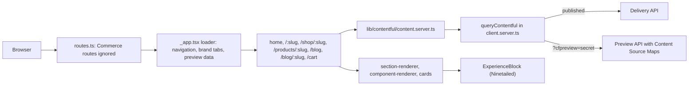

# From Storefront Next Foundations to a Contentful-only storefront

This starter is [Storefront Next Foundations](https://github.com/SalesforceCommerceCloud/storefront-next-foundations) (template release October 2026, upstream commit `8f7f44e`) with Salesforce Commerce disconnected and Contentful wired in for content, Live Preview with the inspector, and Contentful Personalization (Ninetailed). This page lists every change from upstream, grouped by area, so you can review it or re-apply it to a newer Foundations release.

For how the result works day to day, see [README-CONTENTFUL.md](./README-CONTENTFUL.md). For the content model, see [README-DEMO-2.0-CONTENT-MODEL.md](./README-DEMO-2.0-CONTENT-MODEL.md).

## 1. Salesforce Commerce is disconnected, not deleted

| File | Change |
| --- | --- |
| `src/routes.ts` | `COMMERCE_ROUTE_FILES` ignores account, checkout, order, SCAPI PLP/PDP (`_app.c.$`, `_app.p.$`), search, wishlist, store locator, CMS, login/signup/password, OAuth JWKS, Page Designer preview, and every `action.*` and `resource.*` route. `react-router typegen` still sees them, because components import their generated `+types`, which keeps `pnpm typecheck` green. |
| `src/root.tsx` | Removes the SLAS auth, basket, shopper-context, user-type-hint, Page Designer resolution and attribution-forwarding middlewares. Every visitor gets a fixed guest session, and the basket snapshot is `null`. Drops `AuthActionExecutor`, `BasketCookieReconciler`, `CartMutationToastWatcher`, `TrackingConsentBanner` and `PageViewTracker`. Adds `data-brand` on `<html>`. |
| `src/routes/_app.tsx` | Layout loader reads Contentful navigation, brand tabs and personalization preview data. It renders the Contentful header, footer, brand tabs, `PersonalizationProvider` and the Live Preview runtime. |
| `src/routes/_app._index.tsx`, `src/routes/_app.cart.tsx` | Rewritten for the Contentful home page and the mock cart. |
| `src/middlewares/app-config.server.ts` | Commerce API credentials (`clientId`, `organizationId`, `shortCode`) are no longer required at startup. Site and `defaultSiteId` checks remain. |
| `vite.config.ts`, `vite-plugins/env-validation.ts` | The dev-only short-code check is removed, so `pnpm dev` starts with the Salesforce variables commented out. |
| Tests | Deleted `_app._index.test.tsx`, `_app.cart.test.tsx`, `_app.cart.loader.test.ts`, `_app.test.tsx`. Updated `routes.test.ts`, `root.test.tsx`, `test-utils/config.ts` and the store-locator route test. |

To bring a Commerce route back, remove its pattern from `COMMERCE_ROUTE_FILES`, re-register the middlewares it needs in `src/root.tsx`, and set the Salesforce variables in `.env`.

## 2. Configuration

| File | Change |
| --- | --- |
| `src/types/config.ts` | Adds `ContentfulSpaceConfig`, `ContentfulBrandConfig`, `app.contentful` (`spaces`, `brands`) and `app.personalization` (`clientId`, `environment`). |
| `config.server.base.ts` | `contentful.spaces.brand` (space ID and environment) and the brands (`rawlings` with the alternate `Rawlings2` content set, and `easton`). Empty personalization defaults. |
| `config.server.ts` | One storefront site per brand (`sitesFromDal: false`, `defaultSiteId: 'rawlings'`). Preconnects to `images.ctfassets.net`. Security headers are covered in section 5. |
| `src/route-paths.ts` | Adds `contentPage`, `shop`, `shopCategory`, `products`, `product`. |
| `.env.default`, `.env` | Contentful and Ninetailed variables only. The Salesforce and Managed Runtime variables are commented out. |

## 3. Contentful data layer: `src/lib/contentful/`

| File | Purpose |
| --- | --- |
| `client.server.ts` | `queryContentful()`, the one way code reads Contentful. You name a space by its config key, and tokens come from `CONTENTFUL_<KEY>_DELIVERY_TOKEN` / `_PREVIEW_TOKEN`. It adds timeouts (4s, or 8s in preview), a 60s per-instance cache for published content (`CONTENTFUL_PAGE_CACHE_TTL_MS`) and in-flight deduplication. |
| `content.server.ts` | Queries for landing pages, products, categories, blog posts and the blog listing page, dynamic collections, navigation, company logos, experiences and audiences. |
| `brand.ts` | Brand scoping by internal-name prefix and slug suffix, `useBrand()`. |
| `route.server.ts`, `preview.server.ts` | Per-request brand and preview resolution. Preview requires `?cfpreview=` to match `CONTENTFUL_PREVIEW_SECRET`. |
| `preview-target.server.ts` | Finds the page that shows an entry, searching up to four link levels, for `/contentful-preview`. |
| `types.ts`, `media.ts`, `links.ts`, `rich-text.ts`, `product.ts` | Field typings, image resolution with focal points, href resolution, rich text helpers, product price. |
| `blog.ts` | Author names and bylines, and the `dynamicCollection` type mapping and item merging. |
| `inspector.ts`, `live-preview.ts` | Live Preview tags, plus stega stripping and cycle breaking (section 5). |

## 4. Routes and components

| Path | Purpose |
| --- | --- |
| `src/routes/_app.$slug.tsx` | Any brand `landingPage` by slug. |
| `src/routes/_app.shop.$slug.tsx` | PLP for a `productCategory`. |
| `src/routes/_app.products.$slug.tsx` | PDP for a `product`. |
| `src/routes/_app.blog._index.tsx`, `src/routes/_app.blog.$slug.tsx` | Blog index (brand posts, optional blog `dynamicListingPage`) and post page. |
| `src/routes/contentful-preview.ts` | Entry ID to page redirect, used by the Contentful content preview URL. |
| `src/components/contentful/` | `landing-page`, `category-listing`, `product-detail`, `content-image`, `content-link`, `content-seo`. |
| `src/components/contentful/sections/` | `section-renderer`, `component-renderer` (banner, callToAction, collection, dynamicCollection), `cards`, `banner`, `banner-carousel`, `call-to-action`, `collection`, `rich-text`. |
| `src/components/contentful/blog/` | `blog-listing`, `blog-post`, `blog-post-body` (rich-text embeds and tables in post bodies). |
| `src/components/contentful/layout/` | `site-header`, `site-footer`, `brand-tabs`. |
| `src/theme/overrides/brands.css` (imported from `shared.css`), `public/images/brands/rawlings-logo.png` | Per-brand primary color keyed on `<html data-brand>`, and the self-hosted Rawlings wordmark. |

## 5. Live Preview with the inspector

- `?cfpreview=<secret>` switches the request to the Preview API with Content Source Maps, marks the page `noindex`, and carries the parameter on internal links (`usePreviewSearch()`). Cookies are unreliable inside the editor iframe.
- `src/components/contentful/live-preview/` lazy-loads `@contentful/live-preview` with **inspector mode and live updates on**. Every editor save re-runs the route loaders, so the page stays a server render of the latest draft. Ahead of the save, `useLiveEntry` renders each entry's in-editor edits as they're typed (the SDK's `subscribe('edit')`), and `useLiveOrder` reorders sections by entry ID the moment the editor drags them. Reordered lists are never taken from the editor's merged graph: merged with re-fetched loader data, they left references out of step with the editor.
- `useInspector()` adds `data-contentful-entry-id` / `-field-id` / `-locale` to rendered fields. Outside preview it returns nothing, so production HTML is unchanged.
- `stripStega()` removes Content Source Maps encoding wherever a value is used as an ID, key, URL or metadata. `normalizeExperienceIds()` does the same for Ninetailed experience IDs. `breakCycles()` makes entry graphs JSON-serializable for the Ninetailed preview channel. `entryKeys()` gives unique React keys when an entry is linked twice.
- CSP in `config.server.ts`: `frame-ancestors` allows `app.contentful.com` and `app.eu.contentful.com`, and `X-Frame-Options` is off because it can't express an allow-list. `connect-src`, `img-src` and `media-src` allow the Contentful API, image and video hosts.

## 6. Personalization (Ninetailed 7.25)

- `src/components/personalization/personalization-provider.tsx`: `NinetailedProvider` with the Insights plugin. The preview plugin (audience and variant switcher) is added only in dev and in Contentful preview. It does one `reset()` on a namespace mismatch, and keeps a single browser instance so remounts don't stack preview widgets.
- `experience-block.tsx`: every page section (hero and `sections`) renders through `<Experience>`.
- `src/lib/personalization/use-commerce-tracking.ts`: page views plus product, category, cart, checkout and order events, each with a `brand` property. Also sends `link.eventName` events.
- `mock-auth.ts`, `sign-in.tsx`, `sign-in-dialog.tsx`: a mock sign-in that calls `identify` with demo traits, and a reset-profile action.
- CSP allows `experience.ninetailed.co`, `ingest.insights.ninetailed.co` and the `preview.widgets.ninetailed.io` widget.

## 7. Mock cart

`src/lib/mock-cart/store.ts` and `src/components/mock-cart/` implement a `localStorage` cart per brand, a mini-cart, a quantity stepper, and **Place demo order**, which fires `orderCompleted`.

## 8. Dependencies

Added to `package.json`: `contentful`, `@contentful/live-preview`, `@contentful/rich-text-react-renderer`, `@contentful/rich-text-types`, and `@ninetailed/experience.js` with its `-react`, `-plugin-insights`, `-plugin-preview`, `-preview-bridge` and `-utils-contentful` packages (all `~7.25.0`).

## Re-applying to a newer Foundations release

1. Copy `src/lib/contentful/`, `src/components/contentful/`, `src/components/personalization/`, `src/lib/personalization/`, `src/lib/mock-cart/`, `src/components/mock-cart/`, the new routes (`_app.$slug`, `_app.shop.$slug`, `_app.products.$slug`, `_app.blog.*`, `contentful-preview`), `brands.css`, the brand logo, `contentful/` and the three Contentful docs.
2. Add the dependencies from section 8.
3. Re-apply the edits in sections 1 and 2 by hand. These files change upstream, so merge them rather than overwrite: `routes.ts`, `root.tsx`, `_app.tsx`, `_app._index.tsx`, `_app.cart.tsx`, `app-config.server.ts`, `vite.config.ts`, `config.server*.ts`, `types/config.ts`, `route-paths.ts`, `theme/shared.css`, and the tests.
4. Check `COMMERCE_ROUTE_FILES` against the new release's route files. New Commerce routes need a pattern.
5. Run `pnpm typecheck`, `pnpm lint`, `pnpm test`, then check both brands and `?cfpreview=` in `pnpm dev`.
